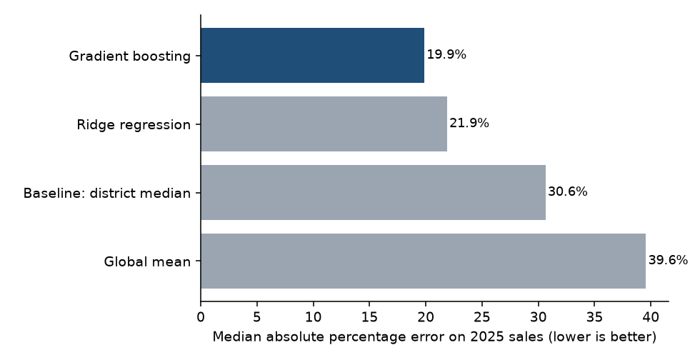
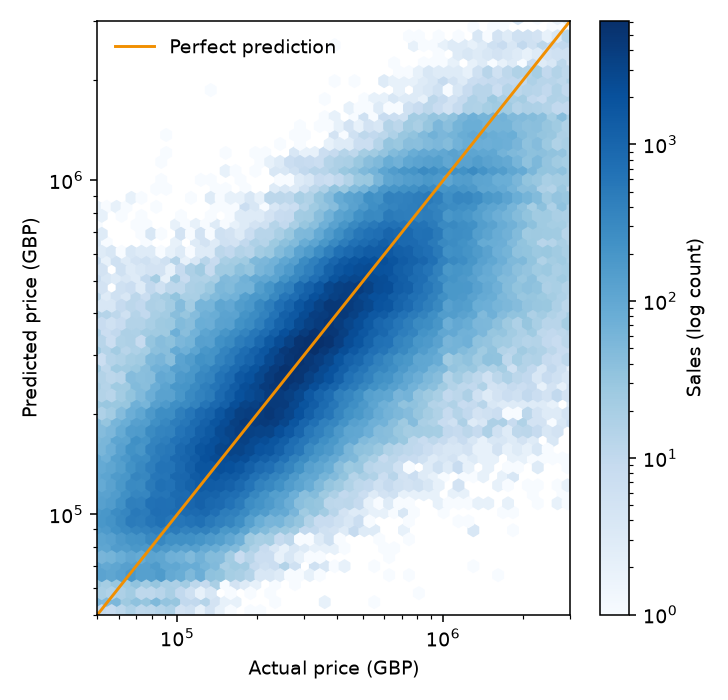
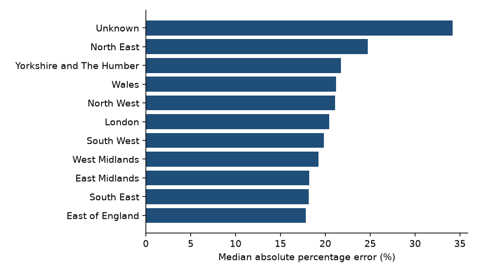
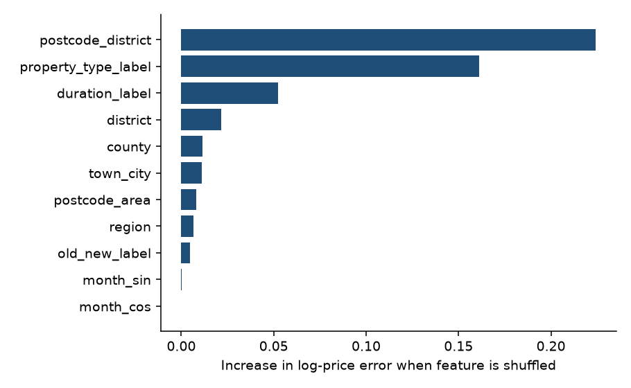

# UK House Price Prediction

[](https://github.com/Pulak-PSR/uk-house-price-prediction/actions/workflows/ci.yml)

Predicting the sale price of a UK home from its location, type, tenure and sale month, using **2.74 million real HM Land Registry sales (2023 to 2025)**.

The model is trained on 2023 and 2024 sales and tested on **all 2025 sales it has never seen**, which is how it would be used in practice.

This project builds on [`uk-property-price-pipeline`](https://github.com/Pulak-PSR/uk-property-price-pipeline), which downloads, cleans and validates the data.

## Result

| Model | Median % error | Within 20% of true price | MAE | R² (log price) |
|---|---:|---:|---:|---:|
| Global mean | 39.6% | 25.9% | £182,017 | 0.00 |
| Baseline: district median | 30.6% | 34.4% | £149,786 | 0.33 |
| Ridge regression | 21.9% | 46.4% | £115,756 | 0.59 |
| **Gradient boosting** | **19.9%** | **50.3%** | **£107,643** | **0.64** |

Test set: 966,995 sales from 2025. Training set: 1,776,653 sales from 2023 and 2024.



**Reading this honestly:** the model beats the district-median baseline by about a third (30.6% to 19.9% median error), but half of its predictions are still more than 20% off. That is a limit of the data, not a bug. The Land Registry records no floor area, bedroom count, condition or garden, which are the biggest drivers of a single home's price. With only location, type, tenure and month, this is the ceiling for a model like this, and it should be read as a pricing guide for an area and type, not a valuation.



### Where the model works best and worst

| Region | Median % error |
|---|---:|
| East of England | 17.8% |
| South East | 18.2% |
| East Midlands | 18.2% |
| West Midlands | 19.3% |
| South West | 19.9% |
| London | 20.5% |
| North West | 21.1% |
| Wales | 21.2% |
| Yorkshire and The Humber | 21.8% |
| North East | 24.7% |

Percentage errors are largest in the North East, where prices are lowest and a fixed £ difference is a larger share. London is not the hardest region despite having the widest range of prices.



### What drives the predictions

Permutation importance on the 2025 test set (how much error rises if a feature is shuffled):



The postcode district is the strongest signal, then property type, then tenure (freehold or leasehold). Month of sale adds almost nothing, which matches the near-flat national price over these three years.

## Method

1. **Data**: cleaned output of the pipeline. Rows flagged as outliers (under £10,000 or outside a log-price IQR fence) and rows without a postcode are excluded from modelling only.
2. **Target**: log of price. Prices are heavily right-skewed, and errors on the log scale are percentage errors.
3. **Features**: property type, new build, tenure, region, month (as sin/cos). Geography at five levels (postcode area, postcode district, district, county, town) is **target-encoded**.
4. **No leakage**: the target encoder is fitted with 5-fold cross-fitting inside the training period only, and the split is by date, not random.
5. **No year/trend feature**: tree models cannot extrapolate to an unseen year, so only seasonality is used as a time signal. The cost is that a market-wide price move in 2025 cannot be learned.
6. **Models**: global mean, district median, ridge regression and histogram gradient boosting (scikit-learn).
7. **Metrics**: median absolute percentage error (robust to expensive homes), share within 20%, MAE, RMSE and R² on log price.

## Limitations

- No property size, bedrooms or condition in the data (see above).
- Only 3 years, so the test period is a single year.
- Region comes from a postcode-area lookup and is approximate for areas that straddle regions.
- Prices are not adjusted for inflation or market movement.

## Reproduce

```bash
git clone https://github.com/Pulak-PSR/uk-house-price-prediction.git
cd uk-house-price-prediction
python -m venv .venv && source .venv/bin/activate   # Windows: .venv\Scripts\activate
pip install -e ".[dev]"

# produce data/processed/cleaned.parquet with the pipeline repo first, then:
python -m house_price_model.train --data /path/to/cleaned.parquet

# quick run
python -m house_price_model.train --data /path/to/cleaned.parquet --sample 150000

pytest
```

The full run takes about 3 minutes. It writes `reports/metrics.json` and the figures. The trained model is saved to `models/` (git-ignored).

## Data licence

HM Land Registry Price Paid Data, [Open Government Licence v3.0](https://www.nationalarchives.gov.uk/doc/open-government-licence/version/3/). Contains HM Land Registry data (c) Crown copyright and database right 2026. Code is MIT licensed.

## Skills demonstrated

Supervised regression, feature engineering for high-cardinality categoricals, leakage-safe target encoding, time-based validation, baseline comparison, error analysis by segment, permutation importance, honest reporting of limits, scikit-learn pipelines, pytest, ruff and GitHub Actions CI.
